# Road Insight Database Technical Audit Report
**Project:** Road Insight — Indian Road Safety Analytics & Text-to-SQL Integration  
**Auditor:** Senior Data Engineer & PostgreSQL Database Architect  
**Audit Date:** November 5, 2026  
**PostgreSQL Version:** PostgreSQL 17.10 on x86_64-windows (Compiled by MSVC-19.44.35226, 64-bit)  
**Database Name:** `roadinsight`  
**Application Schema:** `road_insight`  
**Execution Mode:** READ-ONLY Verification (Zero mutation, zero file/pipeline alterations)

---

## Table of Contents
1. [Executive Summary](#1-executive-summary)
2. [Database Overview & Architecture](#2-database-overview--architecture)
3. [Complete Table Inventory](#3-complete-table-inventory)
4. [Detailed Column Schemas](#4-detailed-column-schemas)
5. [Table Relationships & Constraints](#5-table-relationships--constraints)
6. [Mermaid Entity-Relationship Diagram (ERD)](#6-mermaid-entity-relationship-diagram-erd)
7. [Comprehensive Data Profiling Results](#7-comprehensive-data-profiling-results)
8. [Road Accident Domain Understanding](#8-road-accident-domain-understanding)
9. [Data Quality & Business Rules Validation](#9-data-quality--business-rules-validation)
10. [Text-to-SQL Readiness Audit](#10-text-to-sql-readiness-audit)
11. [Recommended Database Schema Context for Groq LLM](#11-recommended-database-schema-context-for-groq-llm)
12. [Text-to-SQL Analytical Test Questions (30 Verified Queries)](#12-text-to-sql-analytical-test-questions-30-verified-queries)
13. [Performance & Indexing Audit](#13-performance--indexing-audit)
14. [Security, Roles & Execution Controls Audit](#14-security-roles--execution-controls-audit)
15. [Known Limitations & Unanswered Questions](#15-known-limitations--unanswered-questions)
16. [Strategic Implementation Roadmap](#16-strategic-implementation-roadmap)

---

## 1. Executive Summary

The **Road Insight** database (`roadinsight`) is a PostgreSQL analytical repository consolidating official road accident statistics published by the Ministry of Road Transport and Highways (MoRTH), Government of India. The database is purpose-built for multi-dimensional analytics across Indian states, union territories, 50 million-plus cities, traffic violations, collision categories, road features, and weather conditions.

### Key Audit Findings:
- **Database Scale:** The database occupies **10,070 kB (~10.3 MB)** with **21 base tables** and **9 analytical views** in the `road_insight` schema. Total populated records across all base tables equal **1,424 rows**.
- **Data Architecture:** The database implements a **Constellation (Multi-Fact) Dimensional Model** in 3rd Normal Form (3NF). It cleanly separates master dimensions (`states`, `cities`, `violation_types`, `collision_types`, `road_features`, `weather_conditions`, `data_sources`) from granular fact tables at distinct aggregate grains (State-Annual, City-Annual, City-Violation, City-Weather, City-Road-Feature, National-Annual, and National-Historical).
- **Referential Integrity & Constraints:** All foreign key constraints are enforced with `ON UPDATE CASCADE ON DELETE RESTRICT`. There are **0 orphan records** across all foreign keys. Check constraints enforce non-negative numbers, valid year ranges (2019–2030), and ranking limits (1–50).
- **Temporal & Spatial Coverage:**
  - **State-level Fact:** Complete 5-year coverage (2019–2023) across 37 States and Union Territories (185 records, 0 missing combinations).
  - **City-level Accident Fact:** 2-year coverage (2022–2023) across 50 million-plus cities (100 records).
  - **City-level Cause & Environmental Facts:** City violations (2023, 300 rows), City weather (2019, 250 rows), City road features (2019, 400 rows).
  - **National Trends:** 5-year macro summary (2019–2023) and 29-year long-term historical time series (1970–2019) with population, registered vehicles, and road length.
- **Text-to-SQL Feasibility:** The database is **highly ready** for an LLM-powered Text-to-SQL feature via the Groq API. However, success depends on feeding explicit system context regarding:
  1. Different grains across tables (e.g., states vs. cities vs. national totals).
  2. The distinction between raw counts and severity rates (fatality rate per 100 accidents vs. rates per 100,000 population).
  3. Handling NULL values in ranking (`ORDER BY ... DESC NULLS LAST`).
  4. The 2020 administrative merger of Daman & Diu into Dadra & Nagar Haveli and Daman & Diu (`is_active = false` for Daman & Diu from 2020 onwards).
  5. Excluding empty staging tables (`stg_*`) from LLM visibility.
- **Security & Execution Gap:** There is currently **no dedicated read-only database role**, and Row Level Security (RLS) is disabled across all tables. A strict read-only execution harness with transaction timeouts, connection sandboxing, and SQL AST parsing must be established before opening the endpoint to user input.

---

## 2. Database Overview & Architecture

### 2.1 System Metadata

| Property | Verified Value |
| :--- | :--- |
| **Database Name** | `roadinsight` |
| **PostgreSQL Version** | `PostgreSQL 17.10 on x86_64-windows, compiled by msvc-19.44.35226, 64-bit` |
| **Active Application Schemas** | `road_insight` (Core analytical schema), `public` (Default empty schema) |
| **Database Disk Size** | `10,070 kB` (10.07 MB) |
| **Base Tables** | 21 tables (11 core analytical tables, 5 dimension tables, 5 staging tables) |
| **Views** | 9 relational views (0 materialized views) |
| **Total Indexes** | 68 indexes across base tables |
| **Total Sequences** | 16 sequences (supporting auto-increment identity keys) |
| **Custom Functions / Procedures** | 0 custom user-defined stored procedures (Pure declarative SQL ETL & views) |
| **Total Populated Rows** | **1,424 rows** across active tables (staging tables contain 0 rows) |

### 2.2 Table Sizes & Physical Allocation

| Schema | Table Name | Table Type | Estimated Rows | Exact Rows | Total Disk Size | Table Size | Index Size |
| :--- | :--- | :--- | :--- | :--- | :--- | :--- | :--- |
| `road_insight` | `state_annual_stats` | Core Fact Table | 185 | 185 | 168 kB | 48 kB | 120 kB |
| `road_insight` | `city_road_feature_stats` | Core Fact Table | 400 | 400 | 152 kB | 64 kB | 88 kB |
| `road_insight` | `city_weather_stats` | Core Fact Table | 250 | 250 | 144 kB | 56 kB | 88 kB |
| `road_insight` | `city_violation_stats` | Core Fact Table | 300 | 300 | 144 kB | 56 kB | 88 kB |
| `road_insight` | `city_accident_stats` | Core Fact Table | 100 | 100 | 120 kB | 40 kB | 80 kB |
| `road_insight` | `collision_type_stats` | Core Fact Table | 18 | 18 | 72 kB | 16 kB | 56 kB |
| `road_insight` | `cities` | Dimension Table | 50 | 50 | 72 kB | 16 kB | 56 kB |
| `road_insight` | `violation_type_stats` | Core Fact Table | 12 | 12 | 72 kB | 16 kB | 56 kB |
| `road_insight` | `states` | Dimension Table | 37 | 37 | 64 kB | 16 kB | 48 kB |
| `road_insight` | `national_historical_stats` | Historical Fact | 29 | 29 | 56 kB | 16 kB | 40 kB |
| `road_insight` | `national_annual_stats` | Core Fact Table | 5 | 5 | 56 kB | 16 kB | 40 kB |
| `road_insight` | `collision_types` | Dimension Table | 9 | 9 | 48 kB | 16 kB | 32 kB |
| `road_insight` | `weather_conditions` | Dimension Table | 5 | 5 | 48 kB | 16 kB | 32 kB |
| `road_insight` | `violation_types` | Dimension Table | 6 | 6 | 48 kB | 16 kB | 32 kB |
| `road_insight` | `road_features` | Dimension Table | 8 | 8 | 48 kB | 16 kB | 32 kB |
| `road_insight` | `data_sources` | Dimension Table | 10 | 10 | 32 kB | 16 kB | 16 kB |
| `road_insight` | `stg_road_state_acc` | Staging Table | 0 | 0 | 16 kB | 0 kB | 16 kB |
| `road_insight` | `stg_road_state_killed` | Staging Table | 0 | 0 | 16 kB | 0 kB | 16 kB |
| `road_insight` | `stg_road_no_acc` | Staging Table | 0 | 0 | 16 kB | 0 kB | 16 kB |
| `road_insight` | `stg_large_cities_vio` | Staging Table | 0 | 0 | 16 kB | 0 kB | 16 kB |
| `road_insight` | `stg_large_cities` | Staging Table | 0 | 0 | 16 kB | 0 kB | 16 kB |

---

## 3. Complete Table Inventory

The tables in `road_insight` fall into three functional layers:

### 3.1 Master Dimension Tables
1. **`states`**: Master registry of 28 States and 9 Union Territories of India (37 entities). Contains official classification (`State` vs `Union Territory`) and administrative merger tracking (`is_active = false` for historical Daman & Diu).
2. **`cities`**: Master list of 50 Indian cities with a population of over 1 million, mapped to their respective `state_id`.
3. **`violation_types`**: 6 canonical traffic violation classifications (Over-speeding, Drunken driving, Wrong-side driving, Red-light jumping, Mobile phone usage, Others).
4. **`collision_types`**: 9 collision categories (Hit and Run, Parked Vehicle, Hit from Back, Hit from Side, Run off Road, Fixed Object, Vehicle Overturn, Head-on Collision, Others).
5. **`road_features`**: 8 roadway physical characteristics (Straight Road, Curved Road, Bridge, Culvert, Pot Holes, Steep Grade, Under Construction, Others).
6. **`weather_conditions`**: 5 atmospheric condition categories (Sunny/Clear, Rainy, Foggy and Misty, Hail/Sleet, Others).
7. **`data_sources`**: Lineage and provenance metadata tracking CSV source files, reporting years, and publication documents.

### 3.2 Fact / Statistical Tables
1. **`state_annual_stats`**: State-level annual time series (2019–2023) recording total accident counts, fatalities, official national accident rank, and fatality rank.
2. **`city_accident_stats`**: Annual aggregate statistics (2022–2023) for 50 cities recording total accidents, fatalities, persons injured, and ranks.
3. **`city_violation_stats`**: City-level breakdown of traffic violations causing accidents for the 50 cities (2023).
4. **`city_weather_stats`**: City-level accident, fatality, and injury severity breakdown by weather condition (2019).
5. **`city_road_feature_stats`**: City-level accident, fatality, and injury severity breakdown by road feature/geometry (2019).
6. **`collision_type_stats`**: National-level annual accident and fatality figures segmented by collision type (2022–2023).
7. **`violation_type_stats`**: National-level annual accident and fatality figures segmented by traffic violation (2022–2023).
8. **`national_annual_stats`**: National consolidated figures from 2019 to 2023 with YoY growth rates and severity indices.
9. **`national_historical_stats`**: Longitudinal national time series (1970–2019) containing macro denominators: total population, registered motor vehicles, road network length (km), and per-lakh population rates.

### 3.3 Staging Tables (ETL Intermediaries)
- `stg_large_cities`, `stg_large_cities_vio`, `stg_road_no_acc`, `stg_road_state_acc`, `stg_road_state_killed`.  
  *Audit Note:* These tables are unindexed, unconstrained raw staging structures utilized during pipeline execution. They currently hold 0 rows and **must remain hidden from the Text-to-SQL LLM**.

---

## 4. Detailed Column Schemas

### 4.1 Dimension Tables

#### `states`
| Ord | Column Name | Data Type | Nullable | Default | PK/FK/UQ | Description |
| :--- | :--- | :--- | :--- | :--- | :--- | :--- |
| 1 | `state_id` | `smallint` | NO | `generated by default` | PK | Unique identifier for state/UT |
| 2 | `state_name` | `character varying(60)` | NO | None | UQ | Official name of state or UT |
| 3 | `state_type` | `character varying(20)` | NO | None | None | Categorization: `'State'` or `'Union Territory'` |
| 4 | `is_active` | `boolean` | YES | `true` | None | Active status (`false` for merged Daman & Diu) |
| 5 | `notes` | `text` | YES | None | None | Historical notes on state reorganizations |

#### `cities`
| Ord | Column Name | Data Type | Nullable | Default | PK/FK/UQ | Description |
| :--- | :--- | :--- | :--- | :--- | :--- | :--- |
| 1 | `city_id` | `smallint` | NO | `generated by default` | PK | Unique identifier for city |
| 2 | `city_name` | `character varying(60)` | NO | None | UQ | Name of million-plus city |
| 3 | `state_id` | `smallint` | YES | None | FK | References `states(state_id)` |

#### `violation_types`
| Ord | Column Name | Data Type | Nullable | Default | PK/FK/UQ | Description |
| :--- | :--- | :--- | :--- | :--- | :--- | :--- |
| 1 | `violation_type_id` | `smallint` | NO | `generated by default` | PK | Unique identifier for violation type |
| 2 | `violation_type_name` | `character varying(80)` | NO | None | UQ | Name of violation |
| 3 | `description` | `text` | YES | None | None | Plain English definition of traffic violation |

#### `collision_types`
| Ord | Column Name | Data Type | Nullable | Default | PK/FK/UQ | Description |
| :--- | :--- | :--- | :--- | :--- | :--- | :--- |
| 1 | `collision_type_id` | `smallint` | NO | `generated by default` | PK | Unique identifier for collision type |
| 2 | `collision_type_name` | `character varying(80)` | NO | None | UQ | Name of collision type |
| 3 | `description` | `text` | YES | None | None | Plain English definition of collision mode |

#### `road_features`
| Ord | Column Name | Data Type | Nullable | Default | PK/FK/UQ | Description |
| :--- | :--- | :--- | :--- | :--- | :--- | :--- |
| 1 | `road_feature_id` | `smallint` | NO | `generated by default` | PK | Unique identifier for road feature |
| 2 | `road_feature_name` | `character varying(80)` | NO | None | UQ | Geometric/physical road feature description |
| 3 | `description` | `text` | YES | None | None | Plain English explanation of feature |

#### `weather_conditions`
| Ord | Column Name | Data Type | Nullable | Default | PK/FK/UQ | Description |
| :--- | :--- | :--- | :--- | :--- | :--- | :--- |
| 1 | `weather_condition_id`| `smallint` | NO | `generated by default` | PK | Unique identifier for weather condition |
| 2 | `weather_condition_name`| `character varying(60)`| NO | None | UQ | Name of weather condition |
| 3 | `description` | `text` | YES | None | None | Plain English description of condition |

#### `data_sources`
| Ord | Column Name | Data Type | Nullable | Default | PK/FK/UQ | Description |
| :--- | :--- | :--- | :--- | :--- | :--- | :--- |
| 1 | `source_id` | `smallint` | NO | `generated by default` | PK | Unique identifier for data source |
| 2 | `source_file` | `character varying(100)`| NO | None | None | Raw file name (e.g. `RoadStateWiseAcc.csv`) |
| 3 | `source_directory` | `character varying(100)`| YES | None | None | Relative directory path |
| 4 | `description` | `text` | YES | None | None | Content summary of dataset |
| 5 | `report_year` | `smallint` | YES | None | None | MoRTH publication year |
| 6 | `data_year_min` | `smallint` | YES | None | None | Earliest data year covered |
| 7 | `data_year_max` | `smallint` | YES | None | None | Latest data year covered |
| 8 | `geographic_scope`| `character varying(30)` | YES | None | None | `'National'`, `'State'`, or `'City'` |
| 9 | `notes` | `text` | YES | None | None | Data cleaning notes and disclaimers |
| 10| `loaded_at` | `timestamptz` | YES | `now()` | None | Timestamp of ETL loading |

---

### 4.2 Analytical Fact Tables

#### `state_annual_stats`
| Ord | Column Name | Data Type | Nullable | Default | PK/FK/UQ | Description |
| :--- | :--- | :--- | :--- | :--- | :--- | :--- |
| 1 | `stat_id` | `bigint` | NO | `generated by default` | PK | Surrogate primary key |
| 2 | `state_id` | `smallint` | NO | None | FK, UQ (1/2)| References `states(state_id)` |
| 3 | `year` | `smallint` | NO | None | UQ (2/2)| Observation year (2019–2023) |
| 4 | `source_id` | `smallint` | NO | None | FK | References `data_sources(source_id)` |
| 5 | `accident_count` | `integer` | YES | None | None | Total road accidents in state and year |
| 6 | `accident_rank` | `smallint` | YES | None | None | National rank by accident count (1 = highest) |
| 7 | `persons_killed` | `integer` | YES | None | None | Total fatalities in state and year |
| 8 | `killed_rank` | `smallint` | YES | None | None | National rank by fatalities (1 = highest) |
| 9 | `loaded_at` | `timestamptz` | YES | `now()` | None | ETL load timestamp |

#### `city_accident_stats`
| Ord | Column Name | Data Type | Nullable | Default | PK/FK/UQ | Description |
| :--- | :--- | :--- | :--- | :--- | :--- | :--- |
| 1 | `stat_id` | `bigint` | NO | `generated by default` | PK | Surrogate primary key |
| 2 | `city_id` | `smallint` | NO | None | FK, UQ (1/2)| References `cities(city_id)` |
| 3 | `year` | `smallint` | NO | None | UQ (2/2)| Observation year (2022–2023) |
| 4 | `source_id` | `smallint` | NO | None | FK | References `data_sources(source_id)` |
| 5 | `accident_count` | `integer` | NO | None | None | Total road accidents in city |
| 6 | `persons_killed` | `integer` | NO | None | None | Total fatalities in city |
| 7 | `persons_injured`| `integer` | NO | None | None | Total injured persons in city |
| 8 | `accident_rank` | `smallint` | YES | None | None | 50-city ranking by accident count |
| 9 | `killed_rank` | `smallint` | YES | None | None | 50-city ranking by fatalities |
| 10| `injured_rank` | `smallint` | YES | None | None | 50-city ranking by injured persons |
| 11| `loaded_at` | `timestamptz` | YES | `now()` | None | ETL load timestamp |

#### `city_violation_stats`
| Ord | Column Name | Data Type | Nullable | Default | PK/FK/UQ | Description |
| :--- | :--- | :--- | :--- | :--- | :--- | :--- |
| 1 | `stat_id` | `bigint` | NO | `generated by default` | PK | Surrogate primary key |
| 2 | `city_id` | `smallint` | NO | None | FK, UQ (1/3)| References `cities(city_id)` |
| 3 | `year` | `smallint` | NO | None | UQ (2/3)| Data year (2023) |
| 4 | `violation_type_id`| `smallint` | NO | None | FK, UQ (3/3)| References `violation_types(violation_type_id)` |
| 5 | `source_id` | `smallint` | NO | None | FK | References `data_sources(source_id)` |
| 6 | `accident_count` | `integer` | NO | None | None | Accidents caused by this specific violation |
| 7 | `loaded_at` | `timestamptz` | YES | `now()` | None | ETL load timestamp |

#### `city_weather_stats`
| Ord | Column Name | Data Type | Nullable | Default | PK/FK/UQ | Description |
| :--- | :--- | :--- | :--- | :--- | :--- | :--- |
| 1 | `stat_id` | `bigint` | NO | `generated by default` | PK | Surrogate primary key |
| 2 | `city_id` | `smallint` | NO | None | FK, UQ (1/3)| References `cities(city_id)` |
| 3 | `year` | `smallint` | NO | `2019` | UQ (2/3)| Data year (2019) |
| 4 | `weather_condition_id`| `smallint` | NO| None | FK, UQ (3/3)| References `weather_conditions` |
| 5 | `source_id` | `smallint` | NO | None | FK | References `data_sources(source_id)` |
| 6 | `accident_count` | `integer` | NO | None | None | Accidents under this weather condition |
| 7 | `persons_killed` | `integer` | NO | None | None | Fatalities under this weather condition |
| 8 | `persons_grievously_injured` | `integer` | NO | None | None | Grievously injured under this weather |
| 9 | `persons_minor_injured` | `integer` | NO | None | None | Minor injured under this weather |
| 10| `persons_total_injured` | `integer` | NO | None | None | Total injured (`grievous + minor`) |
| 11| `loaded_at` | `timestamptz` | YES | `now()` | None | ETL load timestamp |

#### `city_road_feature_stats`
| Ord | Column Name | Data Type | Nullable | Default | PK/FK/UQ | Description |
| :--- | :--- | :--- | :--- | :--- | :--- | :--- |
| 1 | `stat_id` | `bigint` | NO | `generated by default` | PK | Surrogate primary key |
| 2 | `city_id` | `smallint` | NO | None | FK, UQ (1/3)| References `cities(city_id)` |
| 3 | `year` | `smallint` | NO | `2019` | UQ (2/3)| Data year (2019) |
| 4 | `road_feature_id` | `smallint` | NO | None | FK, UQ (3/3)| References `road_features` |
| 5 | `source_id` | `smallint` | NO | None | FK | References `data_sources(source_id)` |
| 6 | `accident_count` | `integer` | NO | None | None | Accidents on this road feature |
| 7 | `persons_killed` | `integer` | NO | None | None | Fatalities on this road feature |
| 8 | `persons_grievously_injured` | `integer` | NO | None | None | Grievously injured on this feature |
| 9 | `persons_minor_injured` | `integer` | NO | None | None | Minor injured on this feature |
| 10| `persons_total_injured` | `integer` | NO | None | None | Total injured (`grievous + minor`) |
| 11| `loaded_at` | `timestamptz` | YES | `now()` | None | ETL load timestamp |

#### `collision_type_stats`
| Ord | Column Name | Data Type | Nullable | Default | PK/FK/UQ | Description |
| :--- | :--- | :--- | :--- | :--- | :--- | :--- |
| 1 | `stat_id` | `bigint` | NO | `generated by default` | PK | Surrogate primary key |
| 2 | `collision_type_id`| `smallint` | NO | None | FK, UQ (1/2)| References `collision_types` |
| 3 | `year` | `smallint` | NO | None | UQ (2/2)| Data year (2022–2023) |
| 4 | `source_id` | `smallint` | NO | None | FK | References `data_sources(source_id)` |
| 5 | `accident_count` | `integer` | NO | None | None | National accidents of this collision type |
| 6 | `persons_killed` | `integer` | NO | None | None | National fatalities of this collision type |
| 7 | `persons_injured`| `integer` | NO | None | None | National injuries of this collision type |
| 8 | `loaded_at` | `timestamptz` | YES | `now()` | None | ETL load timestamp |

#### `violation_type_stats`
| Ord | Column Name | Data Type | Nullable | Default | PK/FK/UQ | Description |
| :--- | :--- | :--- | :--- | :--- | :--- | :--- |
| 1 | `stat_id` | `bigint` | NO | `generated by default` | PK | Surrogate primary key |
| 2 | `violation_type_id`| `smallint` | NO | None | FK, UQ (1/2)| References `violation_types` |
| 3 | `year` | `smallint` | NO | None | UQ (2/2)| Data year (2022–2023) |
| 4 | `source_id` | `smallint` | NO | None | FK | References `data_sources(source_id)` |
| 5 | `accident_count` | `integer` | NO | None | None | National accidents due to this violation |
| 6 | `persons_killed` | `integer` | NO | None | None | National fatalities due to this violation |
| 7 | `persons_injured`| `integer` | NO | None | None | National injuries due to this violation |
| 8 | `loaded_at` | `timestamptz` | YES | `now()` | None | ETL load timestamp |

#### `national_annual_stats`
| Ord | Column Name | Data Type | Nullable | Default | PK/FK/UQ | Description |
| :--- | :--- | :--- | :--- | :--- | :--- | :--- |
| 1 | `stat_id` | `bigint` | NO | `generated by default` | PK | Surrogate primary key |
| 2 | `year` | `smallint` | NO | None | UQ | Observation year (2019–2023) |
| 3 | `source_id` | `smallint` | NO | None | FK | References `data_sources(source_id)` |
| 4 | `total_accidents` | `integer` | NO | None | None | Consolidated national accidents |
| 5 | `total_fatalities`| `integer` | NO | None | None | Consolidated national fatalities |
| 6 | `total_injured` | `integer` | NO | None | None | Consolidated national injured persons |
| 7 | `accidents_pct_change` | `numeric(5,2)` | YES | None | None | YoY percentage change in accidents |
| 8 | `fatalities_pct_change`| `numeric(5,2)` | YES | None | None | YoY percentage change in fatalities |
| 9 | `injured_pct_change` | `numeric(5,2)` | YES | None | None | YoY percentage change in injured persons |
| 10| `loaded_at` | `timestamptz` | YES | `now()` | None | ETL load timestamp |

#### `national_historical_stats`
| Ord | Column Name | Data Type | Nullable | Default | PK/FK/UQ | Description |
| :--- | :--- | :--- | :--- | :--- | :--- | :--- |
| 1 | `stat_id` | `bigint` | NO | `generated by default` | PK | Surrogate primary key |
| 2 | `year` | `smallint` | NO | None | UQ | Historical year (1970–2019) |
| 3 | `source_id` | `smallint` | NO | None | FK | References `data_sources(source_id)` |
| 4 | `total_accidents` | `integer` | YES | None | None | Total national accidents |
| 5 | `fatal_accidents` | `integer` | YES | None | None | Count of accidents resulting in death |
| 6 | `total_killed` | `integer` | YES | None | None | Total persons killed |
| 7 | `total_injured` | `integer` | YES | None | None | Total persons injured |
| 8 | `population_thousands` | `numeric(12,3)`| YES | None | None | Mid-year population estimate (in thousands) |
| 9 | `registered_vehicles_thousands` | `numeric(12,3)`| YES | None | None | Total registered motor vehicles (in thousands) |
| 10| `road_length_km` | `numeric(12,2)`| YES | None | None | Total road network length (km) |
| 11| `accidents_per_ten_thousand_vehicles` | `numeric(8,4)` | YES | None | None | Rate per 10,000 registered motor vehicles |
| 12| `killed_per_ten_thousand_vehicles` | `numeric(8,4)` | YES | None | None | Rate per 10,000 registered motor vehicles |
| 13| `injured_per_ten_thousand_vehicles` | `numeric(8,4)` | YES | None | None | Rate per 10,000 registered motor vehicles |
| 14| `accidents_per_ten_thousand_km_road` | `numeric(10,4)`| YES | None | None | Rate per 10,000 km of road length |
| 15| `killed_per_ten_thousand_km_road` | `numeric(10,4)`| YES | None | None | Rate per 10,000 km of road length |
| 16| `injured_per_ten_thousand_km_road` | `numeric(10,4)`| YES | None | None | Rate per 10,000 km of road length |
| 17| `accidents_per_lakh_pop` | `numeric(8,4)` | YES | None | None | Rate per 100,000 population (Accidents) |
| 18| `killed_per_lakh_pop` | `numeric(8,4)` | YES | None | None | Rate per 100,000 population (Fatalities) |
| 19| `injured_per_lakh_pop` | `numeric(8,4)` | YES | None | None | Rate per 100,000 population (Injuries) |

---

## 5. Table Relationships & Constraints

### 5.1 Foreign Key Inventory

All foreign keys in the database are rigorously defined with standard referential behavior:
- **ON DELETE:** `RESTRICT` (Prevents accidental loss of historical records if a master entity is deleted).
- **ON UPDATE:** `CASCADE` (Permits primary key code updates to propagate automatically).

| Source Table | Source Column | Referenced Table | Referenced Column | Relationship Cardinality | ON DELETE | ON UPDATE |
| :--- | :--- | :--- | :--- | :--- | :--- | :--- |
| `cities` | `state_id` | `states` | `state_id` | N : 1 | `RESTRICT` | `CASCADE` |
| `city_accident_stats` | `city_id` | `cities` | `city_id` | N : 1 | `RESTRICT` | `CASCADE` |
| `city_accident_stats` | `source_id` | `data_sources` | `source_id` | N : 1 | `RESTRICT` | `CASCADE` |
| `city_road_feature_stats` | `city_id` | `cities` | `city_id` | N : 1 | `RESTRICT` | `CASCADE` |
| `city_road_feature_stats` | `road_feature_id` | `road_features` | `road_feature_id` | N : 1 | `RESTRICT` | `CASCADE` |
| `city_road_feature_stats` | `source_id` | `data_sources` | `source_id` | N : 1 | `RESTRICT` | `CASCADE` |
| `city_violation_stats` | `city_id` | `cities` | `city_id` | N : 1 | `RESTRICT` | `CASCADE` |
| `city_violation_stats` | `violation_type_id` | `violation_types` | `violation_type_id`| N : 1 | `RESTRICT` | `CASCADE` |
| `city_violation_stats` | `source_id` | `data_sources` | `source_id` | N : 1 | `RESTRICT` | `CASCADE` |
| `city_weather_stats` | `city_id` | `cities` | `city_id` | N : 1 | `RESTRICT` | `CASCADE` |
| `city_weather_stats` | `weather_condition_id`| `weather_conditions` | `weather_condition_id`| N : 1 | `RESTRICT` | `CASCADE` |
| `city_weather_stats` | `source_id` | `data_sources` | `source_id` | N : 1 | `RESTRICT` | `CASCADE` |
| `collision_type_stats` | `collision_type_id` | `collision_types` | `collision_type_id`| N : 1 | `RESTRICT` | `CASCADE` |
| `collision_type_stats` | `source_id` | `data_sources` | `source_id` | N : 1 | `RESTRICT` | `CASCADE` |
| `national_annual_stats` | `source_id` | `data_sources` | `source_id` | N : 1 | `RESTRICT` | `CASCADE` |
| `national_historical_stats`| `source_id` | `data_sources` | `source_id` | N : 1 | `RESTRICT` | `CASCADE` |
| `state_annual_stats` | `state_id` | `states` | `state_id` | N : 1 | `RESTRICT` | `CASCADE` |
| `state_annual_stats` | `source_id` | `data_sources` | `source_id` | N : 1 | `RESTRICT` | `CASCADE` |
| `violation_type_stats` | `violation_type_id` | `violation_types` | `violation_type_id`| N : 1 | `RESTRICT` | `CASCADE` |
| `violation_type_stats` | `source_id` | `data_sources` | `source_id` | N : 1 | `RESTRICT` | `CASCADE` |

### 5.2 Unique Constraints
- **`states`:** `uq_states_name` (`state_name`)
- **`cities`:** `uq_cities_name` (`city_name`)
- **`violation_types`:** `violation_types_violation_type_name_key` (`violation_type_name`)
- **`collision_types`:** `collision_types_collision_type_name_key` (`collision_type_name`)
- **`weather_conditions`:** `weather_conditions_weather_condition_name_key` (`weather_condition_name`)
- **`road_features`:** `road_features_road_feature_name_key` (`road_feature_name`)
- **`state_annual_stats`:** `uq_state_year` (`state_id, year`)
- **`city_accident_stats`:** `uq_city_acc_year` (`city_id, year`)
- **`city_violation_stats`:** `uq_city_vio_year_type` (`city_id, year, violation_type_id`)
- **`city_weather_stats`:** `uq_city_weather` (`city_id, year, weather_condition_id`)
- **`city_road_feature_stats`:** `uq_city_road_feat` (`city_id, year, road_feature_id`)
- **`collision_type_stats`:** `uq_coll_type_year` (`collision_type_id, year`)
- **`violation_type_stats`:** `uq_viol_type_year` (`violation_type_id, year`)
- **`national_annual_stats`:** `uq_nat_ann_year` (`year`)
- **`national_historical_stats`:** `uq_nat_hist_year` (`year`)

### 5.3 Check Constraints
- **Non-negativity Checks:** All count metrics (`accident_count >= 0`, `persons_killed >= 0`, `persons_injured >= 0`, `persons_grievously_injured >= 0`, `persons_minor_injured >= 0`, `persons_total_injured >= 0`) across all statistical tables.
- **Year Bounds:** `year BETWEEN 2019 AND 2030` on operational tables; `year BETWEEN 1970 AND 2030` on `national_historical_stats`.
- **Ranking Bounds:** `accident_rank BETWEEN 1 AND 50`, `killed_rank BETWEEN 1 AND 50`, `injured_rank BETWEEN 1 AND 50` on city stats; `accident_rank BETWEEN 1 AND 37`, `killed_rank BETWEEN 1 AND 37` on state stats.

---

## 6. Mermaid Entity-Relationship Diagram (ERD)

```mermaid
erDiagram
    STATES ||--o{ CITIES : "locates"
    STATES ||--o{ STATE_ANNUAL_STATS : "reports"
    DATA_SOURCES ||--o{ STATE_ANNUAL_STATS : "sources"
    
    CITIES ||--o{ CITY_ACCIDENT_STATS : "records"
    DATA_SOURCES ||--o{ CITY_ACCIDENT_STATS : "sources"
    
    CITIES ||--o{ CITY_VIOLATION_STATS : "incurs"
    VIOLATION_TYPES ||--o{ CITY_VIOLATION_STATS : "categorizes"
    DATA_SOURCES ||--o{ CITY_VIOLATION_STATS : "sources"
    
    CITIES ||--o{ CITY_WEATHER_STATS : "experiences"
    WEATHER_CONDITIONS ||--o{ CITY_WEATHER_STATS : "conditions"
    DATA_SOURCES ||--o{ CITY_WEATHER_STATS : "sources"
    
    CITIES ||--o{ CITY_ROAD_FEATURE_STATS : "features"
    ROAD_FEATURES ||--o{ CITY_ROAD_FEATURE_STATS : "classifies"
    DATA_SOURCES ||--o{ CITY_ROAD_FEATURE_STATS : "sources"
    
    VIOLATION_TYPES ||--o{ VIOLATION_TYPE_STATS : "tallies"
    DATA_SOURCES ||--o{ VIOLATION_TYPE_STATS : "sources"
    
    COLLISION_TYPES ||--o{ COLLISION_TYPE_STATS : "breaks down"
    DATA_SOURCES ||--o{ COLLISION_TYPE_STATS : "sources"
    
    DATA_SOURCES ||--o{ NATIONAL_ANNUAL_STATS : "sources"
    DATA_SOURCES ||--o{ NATIONAL_HISTORICAL_STATS : "sources"

    STATES {
        smallint state_id PK
        varchar state_name UK
        varchar state_type
        boolean is_active
        text notes
    }

    CITIES {
        smallint city_id PK
        varchar city_name UK
        smallint state_id FK
    }

    VIOLATION_TYPES {
        smallint violation_type_id PK
        varchar violation_type_name UK
        text description
    }

    COLLISION_TYPES {
        smallint collision_type_id PK
        varchar collision_type_name UK
        text description
    }

    WEATHER_CONDITIONS {
        smallint weather_condition_id PK
        varchar weather_condition_name UK
        text description
    }

    ROAD_FEATURES {
        smallint road_feature_id PK
        varchar road_feature_name UK
        text description
    }

    DATA_SOURCES {
        smallint source_id PK
        varchar source_file
        varchar geographic_scope
        smallint report_year
    }

    STATE_ANNUAL_STATS {
        bigint stat_id PK
        smallint state_id FK
        smallint year
        integer accident_count
        smallint accident_rank
        integer persons_killed
        smallint killed_rank
    }

    CITY_ACCIDENT_STATS {
        bigint stat_id PK
        smallint city_id FK
        smallint year
        integer accident_count
        integer persons_killed
        integer persons_injured
        smallint accident_rank
        smallint killed_rank
        smallint injured_rank
    }

    CITY_VIOLATION_STATS {
        bigint stat_id PK
        smallint city_id FK
        smallint year
        smallint violation_type_id FK
        integer accident_count
    }

    CITY_WEATHER_STATS {
        bigint stat_id PK
        smallint city_id FK
        smallint year
        smallint weather_condition_id FK
        integer accident_count
        integer persons_killed
        integer persons_total_injured
    }

    CITY_ROAD_FEATURE_STATS {
        bigint stat_id PK
        smallint city_id FK
        smallint year
        smallint road_feature_id FK
        integer accident_count
        integer persons_killed
        integer persons_total_injured
    }

    COLLISION_TYPE_STATS {
        bigint stat_id PK
        smallint collision_type_id FK
        smallint year
        integer accident_count
        integer persons_killed
        integer persons_injured
    }

    VIOLATION_TYPE_STATS {
        bigint stat_id PK
        smallint violation_type_id FK
        smallint year
        integer accident_count
        integer persons_killed
        integer persons_injured
    }

    NATIONAL_ANNUAL_STATS {
        bigint stat_id PK
        smallint year UK
        integer total_accidents
        integer total_fatalities
        integer total_injured
        numeric accidents_pct_change
    }

    NATIONAL_HISTORICAL_STATS {
        bigint stat_id PK
        smallint year UK
        integer total_accidents
        integer total_killed
        integer total_injured
        numeric population_thousands
        numeric registered_vehicles_thousands
        numeric road_length_km
        numeric accidents_per_lakh_pop
        numeric killed_per_lakh_pop
    }
```



---

## 7. Comprehensive Data Profiling Results

Data profiling was executed across every table and column in the `road_insight` schema.

### 7.1 Statistical Summary of Key Numeric Metrics

| Table | Column | Exact Rows | Null Count (%) | Distinct | Min | Max | Mean | Median | Std Dev |
| :--- | :--- | :--- | :--- | :--- | :--- | :--- | :--- | :--- | :--- |
| `state_annual_stats` | `accident_count` | 185 | 3 (1.62%) | 179 | 0 | 67,213 | 11,940.48 | 4,966.0 | 16,846.12 |
| `state_annual_stats` | `persons_killed` | 185 | 3 (1.62%) | 175 | 0 | 23,652 | 4,428.60 | 2,128.5 | 5,420.73 |
| `state_annual_stats` | `accident_rank` | 185 | 3 (1.62%) | 37 | 1 | 37 | 18.73 | 19.0 | 10.66 |
| `state_annual_stats` | `killed_rank` | 185 | 1 (0.54%) | 37 | 1 | 37 | 18.66 | 19.0 | 10.66 |
| `city_accident_stats` | `accident_count` | 100 | 0 (0.00%) | 98 | 117 | 5,834 | 1,578.96 | 1,261.5 | 1,234.33 |
| `city_accident_stats` | `persons_killed` | 100 | 0 (0.00%) | 93 | 53 | 1,461 | 343.44 | 307.0 | 258.91 |
| `city_accident_stats` | `persons_injured`| 100 | 0 (0.00%) | 98 | 62 | 5,470 | 1,425.28 | 961.0 | 1,289.47 |
| `city_accident_stats` | `accident_rank` | 100 | 0 (0.00%) | 50 | 1 | 50 | 25.50 | 25.5 | 14.50 |
| `city_accident_stats` | `killed_rank` | 100 | 0 (0.00%) | 50 | 1 | 50 | 25.49 | 25.5 | 14.50 |
| `city_accident_stats` | `injured_rank` | 100 | 0 (0.00%) | 50 | 1 | 50 | 25.49 | 25.5 | 14.50 |
| `city_violation_stats` | `accident_count` | 300 | 0 (0.00%) | 179 | 0 | 4,371 | 240.23 | 54.0 | 496.05 |
| `city_weather_stats` | `accident_count` | 250 | 0 (0.00%) | 158 | 0 | 3,923 | 316.35 | 87.5 | 557.06 |
| `city_weather_stats` | `persons_killed` | 250 | 0 (0.00%) | 109 | 0 | 1,072 | 68.32 | 19.5 | 131.86 |
| `city_weather_stats` | `persons_total_injured`| 250 | 0 (0.00%) | 158 | 0 | 3,745 | 283.63 | 74.0 | 511.02 |
| `city_road_feature_stats` | `accident_count` | 400 | 0 (0.00%) | 185 | 0 | 4,122 | 206.95 | 26.0 | 464.21 |
| `city_road_feature_stats` | `persons_killed` | 400 | 0 (0.00%) | 115 | 0 | 1,149 | 44.49 | 6.0 | 108.97 |
| `city_road_feature_stats` | `persons_total_injured`| 400 | 0 (0.00%) | 182 | 0 | 3,694 | 185.30 | 21.0 | 419.86 |
| `collision_type_stats` | `accident_count` | 18 | 0 (0.00%) | 18 | 8,247 | 110,656 | 51,770.83 | 47,848.5 | 31,529.35 |
| `collision_type_stats` | `persons_killed` | 18 | 0 (0.00%) | 18 | 3,097 | 36,804 | 18,393.39 | 18,041.0 | 10,756.90 |
| `violation_type_stats` | `accident_count` | 12 | 0 (0.00%) | 12 | 2,440 | 333,323 | 78,491.25 | 16,333.0 | 118,506.72 |
| `violation_type_stats` | `persons_killed` | 12 | 0 (0.00%) | 12 | 818 | 119,904 | 28,448.42 | 6,647.5 | 42,912.98 |
| `national_annual_stats` | `total_accidents` | 5 | 0 (0.00%) | 5 | 372,181 | 480,652 | 436,827.40 | 456,959.0 | 46,310.22 |
| `national_annual_stats` | `total_fatalities`| 5 | 0 (0.00%) | 5 | 138,383 | 173,016 | 158,958.80 | 158,984.0 | 14,035.79 |
| `national_annual_stats` | `total_injured` | 5 | 0 (0.00%) | 5 | 346,259 | 463,556 | 422,968.20 | 443,366.0 | 45,953.76 |

### 7.2 Categorical Value Profiles
- **`states.state_type`:** `State` (28 occurrences), `Union Territory` (9 occurrences).
- **`states.is_active`:** `true` (36 occurrences), `false` (1 occurrence: Daman & Diu).
- **`violation_types.violation_type_name`:**
  1. `Over-speeding`
  2. `Drunken driving/consumption of alcohol & drug`
  3. `Driving on wrong side/Lane indiscipline`
  4. `Jumping red light`
  5. `Use of mobile phone`
  6. `Others`
- **`collision_types.collision_type_name`:**
  1. `Hit and Run`
  2. `With parked Vehicle`
  3. `Hit from Back`
  4. `Hit from side`
  5. `Run off Road`
  6. `Fixed object`
  7. `Vehicle overturn`
  8. `Head on collision`
  9. `Others`
- **`weather_conditions.weather_condition_name`:**
  1. `Sunny/Clear`
  2. `Rainy`
  3. `Foggy and Misty`
  4. `Hail/Sleet`
  5. `Others`
- **`road_features.road_feature_name`:**
  1. `Straight Road`
  2. `Curved Road`
  3. `Bridge`
  4. `Culvert`
  5. `Pot Holes`
  6. `Steep Grade`
  7. `Ongoing Road Works/Under Construction`
  8. `Others`

### 7.3 Data Hygiene & Empty String Audit
- Across all text columns (`state_name`, `city_name`, `violation_type_name`, `collision_type_name`, `road_feature_name`, `weather_condition_name`), there are **zero empty strings (`''`)** or strings composed solely of whitespace.
- There are no trailing or leading whitespace anomalies in canonical names.

---

## 8. Road Accident Domain Understanding

### 8.1 Domain Entities & Attribute Mapping

| Domain Concept | Available in DB? | Exact Table Name(s) | Exact Column Name(s) | Notes |
| :--- | :--- | :--- | :--- | :--- |
| **State Information** | Yes | `states`, `state_annual_stats` | `state_id`, `state_name`, `state_type` | 28 States, 9 UTs |
| **District Information** | **NO** | *None* | *None* | **Missing in database** |
| **City Information** | Yes | `cities`, `city_accident_stats`, etc. | `city_id`, `city_name`, `state_id` | 50 million-plus cities |
| **Temporal / Year** | Yes | All fact tables | `year` | 1970–2019 (Hist), 2019–2023 (Annual) |
| **Specific Date / Time** | **NO** | *None* | *None* | Granularity is strictly annual |
| **Accident Counts** | Yes | `state_annual_stats`, `city_accident_stats`, etc. | `accident_count`, `total_accidents` | Discrete integer counts |
| **Fatalities / Killed** | Yes | `state_annual_stats`, `city_accident_stats`, etc. | `persons_killed`, `total_fatalities`, `total_killed` | Fatalities stored separately |
| **Injuries** | Yes | `city_accident_stats`, `city_weather_stats`, etc. | `persons_injured`, `persons_total_injured` | Distinguishes grievous vs minor |
| **Vehicle Categories** | **NO** (Categorical)| *None* | *None* | Only aggregated macro count in historical |
| **Road Types** | Yes (Features) | `road_features`, `city_road_feature_stats` | `road_feature_name`, `road_feature_id` | Geometric road features |
| **Rural vs Urban** | **NO** | *None* | *None* | Not explicitly flagged |
| **Accident Causes** | Yes (Violations) | `violation_types`, `city_violation_stats` | `violation_type_name` | Speeding, alcohol, signals, phone |
| **Accident Severity** | Derived / Pre-calc | `state_annual_stats`, `national_annual_stats` | `accident_rank`, `killed_rank`, etc. | Fatality rate derived via SQL |
| **Geographic Coordinates**| **NO** | *None* | *None* | No PostGIS / latitude / longitude |
| **Population Exposure** | Yes (National only) | `national_historical_stats` | `population_thousands`, `registered_vehicles_thousands` | **Not available at state or city level** |

### 8.2 Granularity & Architectural Clarifications

1. **What does one row represent?**
   - In `state_annual_stats`: One annual summary for one specific Indian State or UT in a specific year.
   - In `city_accident_stats`: One annual summary for one specific million-plus city in a specific year.
   - In `city_violation_stats`: One annual summary of accidents attributable to one specific traffic violation in one city in 2023.
   - In `city_weather_stats`: One annual summary of accidents, fatalities, and injuries under a specific weather condition in one city in 2019.
   - In `city_road_feature_stats`: One annual summary of accidents, fatalities, and injuries on a specific road feature in one city in 2019.
   - In `collision_type_stats`: Nationwide annual total for one collision mode in a specific year (2022 or 2023).
   - In `national_historical_stats`: Consolidated nationwide performance metrics for one year between 1970 and 2019.
2. **Individual vs. Aggregated Data:** The database is **100% aggregated statistical data**. It does not store individual accident police FIR logs, vehicle registrations, driver demographics, or incident timestamps.
3. **Geographical Level:** Available at the **State/UT level** (37 entities) and **Large City level** (50 million-plus cities). Sub-district (taluka/tehsil), village, or highway stretch data is absent.
4. **Temporal Granularity:** Strictly **annual (Year)**. There is no monthly, daily, hourly, or day-of-week data.
5. **Separation of Metrics:** Accident counts, fatalities (persons killed), and injuries are stored in separate columns across all tables.
6. **Pre-aggregated Statistics:** Official MoRTH rankings (`accident_rank`, `killed_rank`, `injured_rank`) and YoY percentage changes (`accidents_pct_change`) are pre-aggregated.
7. **Exposure Denominators:** Denominators (population, registered vehicles, road length) exist **only in `national_historical_stats`**. They do not exist for states or cities. Therefore, per-capita state accident rates cannot be computed without supplying external census tables.

---

## 9. Data Quality & Business Rules Validation

### 9.1 Data Quality Audit Findings

1. **Zero Negative Values in Count Columns:** A full schema scan verified that all count columns contain zero negative values. Negative numbers occur exclusively in `national_annual_stats.accidents_pct_change`, `fatalities_pct_change`, and `injured_pct_change` (e.g. 2020 COVID lockdown drop of `-18.5%`), which is valid.
2. **Referential Integrity:** 100% intact. Zero orphaned child rows exist across all 20 foreign key relationships.
3. **No Uniqueness Violations or Duplicates:** The unique constraints `(state_id, year)` and `(city_id, year)` prevent duplicate reporting.
4. **State/Year Combinations:** For the 37 states and 5 years (2019–2023), all 185 rows are present.
5. **The Daman & Diu Merger Anomaly (Verified Business Rule):**
   - In 2020, the Government of India merged the Union Territories of *Dadra & Nagar Haveli* and *Daman & Diu*.
   - In the database, `Daman & Diu` (state_id = 32) has reported stats for 2019, 0 accidents in 2022, and NULL values for 2020, 2021, and 2023. Its `is_active` flag is set to `false`.
   - The merged entity `Dadra & Nagar Haveli and Daman & Diu` (state_id = 31) holds continuous data from 2019 to 2023.
   - *Risk:* If an LLM executes `ORDER BY accident_count DESC` without `WHERE is_active = true` or `NULLS LAST`, PostgreSQL places NULLs at the very top, misrepresenting Daman & Diu.
6. **Cross-Table Summation Differences (Inferred Business Rule):**
   - The sum of accidents across the 50 million-plus cities in 2023 (`81,144`) is approximately **16.9%** of the national total (`480,583`).
   - *Rule:* Cities do NOT sum to state totals, and states do NOT sum from cities. City statistics represent only the 50 designated urban agglomerations with population > 1 million.
7. **Single-Year Granularity for Environmental Tables:**
   - `city_weather_stats` and `city_road_feature_stats` contain data exclusively for **2019**.
   - `city_violation_stats` contains data exclusively for **2023**.
   - Attempting to filter weather or road features for 2022 or 2023 will return empty result sets.

---

## 10. Text-to-SQL Readiness Audit

### 10.1 Table Exposure Matrix

| Table Name | Expose to LLM? | Rationale |
| :--- | :--- | :--- |
| `states` | **YES** | Master dimension for state name resolution and UT filtering. |
| `cities` | **YES** | Master dimension for city name resolution. |
| `state_annual_stats` | **YES** | Primary fact table for state-level accident and fatality questions. |
| `city_accident_stats` | **YES** | Primary fact table for city rankings and city-level trends. |
| `city_violation_stats`| **YES** | City-level traffic violation breakdown (2023). |
| `city_weather_stats` | **YES** | City-level weather conditions (2019). |
| `city_road_feature_stats`| **YES**| City-level road geometry and features (2019). |
| `violation_types` | **YES** | Dimension mapping violation descriptions. |
| `collision_types` | **YES** | Dimension mapping collision modes. |
| `road_features` | **YES** | Dimension mapping road features. |
| `weather_conditions` | **YES** | Dimension mapping weather conditions. |
| `violation_type_stats`| **YES** | National violation totals (2022–2023). |
| `collision_type_stats`| **YES** | National collision breakdown (2022–2023). |
| `national_annual_stats`| **YES**| Official national totals and YoY changes (2019–2023). |
| `national_historical_stats`| **YES**| Long-term historical trends and population-adjusted rates. |
| `data_sources` | **CONDITIONAL**| Expose only if user asks for source document or publication metadata. |
| `stg_*` (All 5 tables)| **NEVER** | Raw staging tables. 0 rows, unconstrained, will confuse LLM schema mapping. |

### 10.2 Potentially Ambiguous Columns & Necessary Disambiguation

1. **`accident_count` vs `total_accidents`:**
   - Fact tables at the state/city level use `accident_count`.
   - `national_annual_stats` and `national_historical_stats` use `total_accidents`.
2. **`persons_killed` vs `total_fatalities` vs `total_killed`:**
   - Operational fact tables use `persons_killed`.
   - `national_annual_stats` uses `total_fatalities`.
   - `national_historical_stats` uses `total_killed`.
   - *Prompt Instruction:* Explicitly alias these as `fatalities` in SQL responses.
3. **`persons_injured` vs `persons_total_injured`:**
   - `city_accident_stats` uses `persons_injured`.
   - `city_weather_stats` and `city_road_feature_stats` use `persons_total_injured`.
4. **Ranking Semantics:**
   - In `accident_rank` and `killed_rank`, **1** means the most dangerous (highest number of accidents/deaths), NOT the safest.
5. **Fatality Rate Definition:**
   - Fatality Rate (Severity) is defined as: `(persons_killed::numeric / NULLIF(accident_count, 0)) * 100`. It represents deaths per 100 accidents.

---

## 11. Recommended Database Schema Context for Groq LLM

When constructing the prompt context for Groq's LLaMA-3/Mixtral model, inject the following system prompt block:

```markdown
### ROAD INSIGHT POSTGRESQL SCHEMA CONTEXT

You are generating READ-ONLY PostgreSQL queries for the 'road_insight' schema.
Always prefix table names with 'road_insight.' or assume search_path includes 'road_insight'.

#### 1. CORE DIMENSION TABLES
- road_insight.states (state_id PK, state_name, state_type ['State', 'Union Territory'], is_active [true/false])
  * Note: Filter 'WHERE is_active = true' when analyzing current states. Daman & Diu was merged in 2020.
- road_insight.cities (city_id PK, city_name, state_id FK -> states.state_id)
  * Represents 50 million-plus Indian cities.
- road_insight.violation_types (violation_type_id PK, violation_type_name ['Over-speeding', 'Drunken driving/consumption of alcohol & drug', 'Driving on wrong side/Lane indiscipline', 'Jumping red light', 'Use of mobile phone', 'Others'])
- road_insight.collision_types (collision_type_id PK, collision_type_name ['Hit and Run', 'With parked Vehicle', 'Hit from Back', 'Hit from side', 'Run off Road', 'Fixed object', 'Vehicle overturn', 'Head on collision', 'Others'])
- road_insight.weather_conditions (weather_condition_id PK, weather_condition_name ['Sunny/Clear', 'Rainy', 'Foggy and Misty', 'Hail/Sleet', 'Others'])
- road_insight.road_features (road_feature_id PK, road_feature_name ['Straight Road', 'Curved Road', 'Bridge', 'Culvert', 'Pot Holes', 'Steere Grade', 'Ongoing Road Works/Under Construction', 'Others'])

#### 2. FACT TABLES
- road_insight.state_annual_stats (stat_id PK, state_id FK, year [2019-2023], accident_count, accident_rank, persons_killed, killed_rank)
- road_insight.city_accident_stats (stat_id PK, city_id FK, year [2022-2023], accident_count, persons_killed, persons_injured, accident_rank, killed_rank, injured_rank)
- road_insight.city_violation_stats (stat_id PK, city_id FK, year [2023], violation_type_id FK, accident_count)
- road_insight.city_weather_stats (stat_id PK, city_id FK, year [2019], weather_condition_id FK, accident_count, persons_killed, persons_total_injured)
- road_insight.city_road_feature_stats (stat_id PK, city_id FK, year [2019], road_feature_id FK, accident_count, persons_killed, persons_total_injured)
- road_insight.violation_type_stats (stat_id PK, violation_type_id FK, year [2022-2023], accident_count, persons_killed, persons_injured)
- road_insight.collision_type_stats (stat_id PK, collision_type_id FK, year [2022-2023], accident_count, persons_killed, persons_injured)
- road_insight.national_annual_stats (stat_id PK, year [2019-2023], total_accidents, total_fatalities, total_injured, accidents_pct_change)
- road_insight.national_historical_stats (stat_id PK, year [1970-2019], total_accidents, total_killed, total_injured, population_thousands, registered_vehicles_thousands, road_length_km, accidents_per_lakh_pop, killed_per_lakh_pop)

#### 3. CRITICAL SQL GENERATION RULES
1. ALWAYS use NULLS LAST when sorting descending: 'ORDER BY column_name DESC NULLS LAST'.
2. Use NULLIF(denominator, 0) to prevent division by zero in rate calculations.
3. Fatality rate per 100 accidents: ROUND((persons_killed::numeric / NULLIF(accident_count, 0)) * 100, 2).
4. NEVER query staging tables ('stg_*').
5. DO NOT generate queries using district or monthly date filters; the data is strictly annual and state/city level.
```

---

## 12. Text-to-SQL Analytical Test Questions (30 Verified Queries)

Every single query below has been tested and verified against the live `roadinsight` PostgreSQL database.

### Category A: Basic Aggregation (5 Questions)

#### Q1: What is the total number of road accidents and fatalities recorded across all states in 2023?
- **SQL:**
  ```sql
  SELECT 
      SUM(accident_count) AS total_accidents,
      SUM(persons_killed) AS total_fatalities
  FROM road_insight.state_annual_stats
  WHERE year = 2023;
  ```
- **Tables Involved:** `state_annual_stats`
- **Columns Involved:** `accident_count`, `persons_killed`, `year`
- **Output:** 1 row (`total_accidents`: 480,583, `total_fatalities`: 172,890)
- **Complexity:** Basic | **Supported:** YES

#### Q2: What is the average number of road accidents per city in the year 2023?
- **SQL:**
  ```sql
  SELECT 
      ROUND(AVG(accident_count), 2) AS avg_accidents_per_city
  FROM road_insight.city_accident_stats
  WHERE year = 2023;
  ```
- **Tables Involved:** `city_accident_stats`
- **Columns Involved:** `accident_count`, `year`
- **Output:** 1 row (`avg_accidents_per_city`: 1,622.88)
- **Complexity:** Basic | **Supported:** YES

#### Q3: How many total fatalities occurred nationwide due to traffic violations in 2023?
- **SQL:**
  ```sql
  SELECT 
      SUM(persons_killed) AS total_violation_fatalities
  FROM road_insight.violation_type_stats
  WHERE year = 2023;
  ```
- **Tables Involved:** `violation_type_stats`
- **Columns Involved:** `persons_killed`, `year`
- **Output:** 1 row (`total_violation_fatalities`: 172,890)
- **Complexity:** Basic | **Supported:** YES

#### Q4: What are the minimum, maximum, and average fatalities recorded across all states between 2019 and 2023?
- **SQL:**
  ```sql
  SELECT 
      MIN(persons_killed) AS min_fatalities,
      MAX(persons_killed) AS max_fatalities,
      ROUND(AVG(persons_killed), 2) AS avg_fatalities
  FROM road_insight.state_annual_stats;
  ```
- **Tables Involved:** `state_annual_stats`
- **Columns Involved:** `persons_killed`
- **Output:** 1 row (`min_fatalities`: 0, `max_fatalities`: 23,652, `avg_fatalities`: 4,428.60)
- **Complexity:** Basic | **Supported:** YES

#### Q5: How many distinct states and union territories are tracked in the database?
- **SQL:**
  ```sql
  SELECT 
      COUNT(*) AS total_entities,
      COUNT(*) FILTER (WHERE state_type = 'State') AS total_states,
      COUNT(*) FILTER (WHERE state_type = 'Union Territory') AS total_uts
  FROM road_insight.states;
  ```
- **Tables Involved:** `states`
- **Columns Involved:** `state_id`, `state_type`
- **Output:** 1 row (`total_entities`: 37, `total_states`: 28, `total_uts`: 9)
- **Complexity:** Basic | **Supported:** YES

---

### Category B: Filtering (5 Questions)

#### Q6: Which states had more than 10,000 road accident fatalities in 2023?
- **SQL:**
  ```sql
  SELECT 
      s.state_name,
      sas.persons_killed
  FROM road_insight.state_annual_stats sas
  JOIN road_insight.states s ON sas.state_id = s.state_id
  WHERE sas.year = 2023 AND sas.persons_killed > 10000
  ORDER BY sas.persons_killed DESC;
  ```
- **Tables Involved:** `state_annual_stats`, `states`
- **Columns Involved:** `state_name`, `persons_killed`, `year`
- **Output:** 6 rows (Uttar Pradesh: 23,652, Tamil Nadu: 18,347, Maharashtra: 15,366, Madhya Pradesh: 13,798, Karnataka: 12,321, Rajasthan: 11,104)
- **Complexity:** Low | **Supported:** YES

#### Q7: What were the accident statistics for the state of Maharashtra for each year from 2019 to 2023?
- **SQL:**
  ```sql
  SELECT 
      sas.year,
      sas.accident_count,
      sas.persons_killed,
      sas.accident_rank,
      sas.killed_rank
  FROM road_insight.state_annual_stats sas
  JOIN road_insight.states s ON sas.state_id = s.state_id
  WHERE s.state_name = 'Maharashtra'
  ORDER BY sas.year ASC;
  ```
- **Tables Involved:** `state_annual_stats`, `states`
- **Columns Involved:** `year`, `accident_count`, `persons_killed`, `accident_rank`, `killed_rank`, `state_name`
- **Output:** 5 rows (2019 through 2023 time series)
- **Complexity:** Low | **Supported:** YES

#### Q8: List all accidents caused by over-speeding across all 50 cities in 2023.
- **SQL:**
  ```sql
  SELECT 
      c.city_name,
      cvs.accident_count
  FROM road_insight.city_violation_stats cvs
  JOIN road_insight.cities c ON cvs.city_id = c.city_id
  JOIN road_insight.violation_types vt ON cvs.violation_type_id = vt.violation_type_id
  WHERE cvs.year = 2023 AND vt.violation_type_name = 'Over-speeding'
  ORDER BY cvs.accident_count DESC;
  ```
- **Tables Involved:** `city_violation_stats`, `cities`, `violation_types`
- **Columns Involved:** `city_name`, `accident_count`, `year`, `violation_type_name`
- **Output:** 50 rows (Bengaluru, Delhi, Indore, etc.)
- **Complexity:** Moderate | **Supported:** YES

#### Q9: Which road features had more than 500 fatalities across all cities in 2019?
- **SQL:**
  ```sql
  SELECT 
      rf.road_feature_name,
      SUM(crfs.persons_killed) AS total_fatalities
  FROM road_insight.city_road_feature_stats crfs
  JOIN road_insight.road_features rf ON crfs.road_feature_id = rf.road_feature_id
  WHERE crfs.year = 2019
  GROUP BY rf.road_feature_name
  HAVING SUM(crfs.persons_killed) > 500
  ORDER BY total_fatalities DESC;
  ```
- **Tables Involved:** `city_road_feature_stats`, `road_features`
- **Columns Involved:** `road_feature_name`, `persons_killed`, `year`
- **Output:** 5 rows (Straight Road: 11,136, Curved Road: 2,010, Bridge: 1,372, etc.)
- **Complexity:** Moderate | **Supported:** YES

#### Q10: Which active states or union territories recorded fewer than 100 accidents in 2023?
- **SQL:**
  ```sql
  SELECT 
      s.state_name,
      s.state_type,
      sas.accident_count,
      sas.persons_killed
  FROM road_insight.state_annual_stats sas
  JOIN road_insight.states s ON sas.state_id = s.state_id
  WHERE sas.year = 2023 
    AND s.is_active = true 
    AND sas.accident_count < 100
  ORDER BY sas.accident_count ASC;
  ```
- **Tables Involved:** `state_annual_stats`, `states`
- **Columns Involved:** `state_name`, `state_type`, `accident_count`, `persons_killed`, `year`, `is_active`
- **Output:** 1 row (Lakshadweep: 1 accident, 0 killed)
- **Complexity:** Low | **Supported:** YES

---

### Category C: Grouping and Ranking (5 Questions)

#### Q11: What are the top 5 states with the highest number of road accidents in 2023?
- **SQL:**
  ```sql
  SELECT 
      s.state_name,
      sas.accident_count,
      sas.accident_rank
  FROM road_insight.state_annual_stats sas
  JOIN road_insight.states s ON sas.state_id = s.state_id
  WHERE sas.year = 2023 
    AND s.is_active = true 
    AND sas.accident_count IS NOT NULL
  ORDER BY sas.accident_count DESC NULLS LAST
  LIMIT 5;
  ```
- **Tables Involved:** `state_annual_stats`, `states`
- **Columns Involved:** `state_name`, `accident_count`, `accident_rank`, `year`
- **Output:** 5 rows (Tamil Nadu: 67,213, Madhya Pradesh: 55,425, Kerala: 48,141, Uttar Pradesh: 44,534, Karnataka: 43,448)
- **Complexity:** Moderate | **Supported:** YES

#### Q12: Rank all 50 cities by total fatalities in 2023.
- **SQL:**
  ```sql
  SELECT 
      c.city_name,
      s.state_name,
      cas.persons_killed,
      RANK() OVER (ORDER BY cas.persons_killed DESC) AS fatality_rank
  FROM road_insight.city_accident_stats cas
  JOIN road_insight.cities c ON cas.city_id = c.city_id
  LEFT JOIN road_insight.states s ON c.state_id = s.state_id
  WHERE cas.year = 2023
  ORDER BY fatality_rank ASC;
  ```
- **Tables Involved:** `city_accident_stats`, `cities`, `states`
- **Columns Involved:** `city_name`, `state_name`, `persons_killed`, `year`
- **Output:** 50 rows ranked (Delhi #1 with 1,457 fatalities, Bengaluru #2 with 915 fatalities)
- **Complexity:** Moderate | **Supported:** YES

#### Q13: What are the top 3 traffic violations causing the highest number of accidents nationally in 2023?
- **SQL:**
  ```sql
  SELECT 
      vt.violation_type_name,
      vts.accident_count,
      vts.persons_killed
  FROM road_insight.violation_type_stats vts
  JOIN road_insight.violation_types vt ON vts.violation_type_id = vt.violation_type_id
  WHERE vts.year = 2023
  ORDER BY vts.accident_count DESC
  LIMIT 3;
  ```
- **Tables Involved:** `violation_type_stats`, `violation_types`
- **Columns Involved:** `violation_type_name`, `accident_count`, `persons_killed`, `year`
- **Output:** 3 rows (Over-speeding: 328,727; Driving on wrong side: 81,999; Drunken driving: 12,256)
- **Complexity:** Moderate | **Supported:** YES

#### Q14: Which collision types caused the most deaths nationally in 2023?
- **SQL:**
  ```sql
  SELECT 
      ct.collision_type_name,
      cts.persons_killed,
      cts.accident_count,
      ROUND((cts.persons_killed::numeric / NULLIF(cts.accident_count, 0)) * 100, 2) AS fatality_rate_pct
  FROM road_insight.collision_type_stats cts
  JOIN road_insight.collision_types ct ON cts.collision_type_id = ct.collision_type_id
  WHERE cts.year = 2023
  ORDER BY cts.persons_killed DESC;
  ```
- **Tables Involved:** `collision_type_stats`, `collision_types`
- **Columns Involved:** `collision_type_name`, `persons_killed`, `accident_count`, `year`
- **Output:** 9 rows (Hit from Back: 36,804 deaths; Head on collision: 30,551 deaths; Hit and Run: 30,486 deaths)
- **Complexity:** Moderate | **Supported:** YES

#### Q15: Group cities by state and calculate the total city accidents per state in 2023.
- **SQL:**
  ```sql
  SELECT 
      s.state_name,
      COUNT(c.city_id) AS num_million_plus_cities,
      SUM(cas.accident_count) AS total_city_accidents,
      SUM(cas.persons_killed) AS total_city_fatalities
  FROM road_insight.city_accident_stats cas
  JOIN road_insight.cities c ON cas.city_id = c.city_id
  JOIN road_insight.states s ON c.state_id = s.state_id
  WHERE cas.year = 2023
  GROUP BY s.state_name
  ORDER BY total_city_accidents DESC;
  ```
- **Tables Involved:** `city_accident_stats`, `cities`, `states`
- **Columns Involved:** `state_name`, `city_id`, `accident_count`, `persons_killed`, `year`
- **Output:** 19 states with million-plus cities (Kerala, Madhya Pradesh, Tamil Nadu, etc.)
- **Complexity:** Moderate | **Supported:** YES

---

### Category D: Multi-Table JOINs (5 Questions)

#### Q16: Show each city with its state name, total accidents, and total fatalities for 2023.
- **SQL:**
  ```sql
  SELECT 
      c.city_name,
      s.state_name,
      cas.accident_count,
      cas.persons_killed
  FROM road_insight.city_accident_stats cas
  JOIN road_insight.cities c ON cas.city_id = c.city_id
  JOIN road_insight.states s ON c.state_id = s.state_id
  WHERE cas.year = 2023
  ORDER BY cas.accident_count DESC;
  ```
- **Tables Involved:** `city_accident_stats`, `cities`, `states`
- **Columns Involved:** `city_name`, `state_name`, `accident_count`, `persons_killed`, `year`
- **Output:** 50 rows
- **Complexity:** Moderate | **Supported:** YES

#### Q17: What is the breakdown of accidents by weather condition in Delhi for 2019?
- **SQL:**
  ```sql
  SELECT 
      c.city_name,
      wc.weather_condition_name,
      cws.accident_count,
      cws.persons_killed,
      cws.persons_total_injured
  FROM road_insight.city_weather_stats cws
  JOIN road_insight.cities c ON cws.city_id = c.city_id
  JOIN road_insight.weather_conditions wc ON cws.weather_condition_id = wc.weather_condition_id
  WHERE c.city_name = 'Delhi' AND cws.year = 2019
  ORDER BY cws.accident_count DESC;
  ```
- **Tables Involved:** `city_weather_stats`, `cities`, `weather_conditions`
- **Columns Involved:** `city_name`, `weather_condition_name`, `accident_count`, `persons_killed`, `persons_total_injured`, `year`
- **Output:** 5 rows (Sunny/Clear: 2,636 accidents; Mist/Fog: 512 accidents, etc.)
- **Complexity:** Moderate | **Supported:** YES

#### Q18: Which city reported the highest number of drunken driving accidents in 2023, and what state is it in?
- **SQL:**
  ```sql
  SELECT 
      c.city_name,
      s.state_name,
      cvs.accident_count AS drunken_driving_accidents
  FROM road_insight.city_violation_stats cvs
  JOIN road_insight.cities c ON cvs.city_id = c.city_id
  JOIN road_insight.states s ON c.state_id = s.state_id
  JOIN road_insight.violation_types vt ON cvs.violation_type_id = vt.violation_type_id
  WHERE cvs.year = 2023 
    AND vt.violation_type_name ILIKE '%drunken%'
  ORDER BY cvs.accident_count DESC
  LIMIT 1;
  ```
- **Tables Involved:** `city_violation_stats`, `cities`, `states`, `violation_types`
- **Columns Involved:** `city_name`, `state_name`, `accident_count`, `violation_type_name`, `year`
- **Output:** 1 row (Kanpur, Uttar Pradesh: 163 accidents)
- **Complexity:** Complex | **Supported:** YES

#### Q19: Compare total road feature accidents on 'Curved Road' vs 'Straight Road' across all cities in 2019.
- **SQL:**
  ```sql
  SELECT 
      rf.road_feature_name,
      SUM(crfs.accident_count) AS total_accidents,
      SUM(crfs.persons_killed) AS total_fatalities
  FROM road_insight.city_road_feature_stats crfs
  JOIN road_insight.road_features rf ON crfs.road_feature_id = rf.road_feature_id
  WHERE crfs.year = 2019 
    AND rf.road_feature_name IN ('Curved Road', 'Straight Road')
  GROUP BY rf.road_feature_name;
  ```
- **Tables Involved:** `city_road_feature_stats`, `road_features`
- **Columns Involved:** `road_feature_name`, `accident_count`, `persons_killed`, `year`
- **Output:** 2 rows (Curved Road: 10,573 accidents / 2,010 fatalities; Straight Road: 49,862 accidents / 11,136 fatalities)
- **Complexity:** Moderate | **Supported:** YES

#### Q20: List 10 states along with their data source file name and data reporting year for 2023.
- **SQL:**
  ```sql
  SELECT 
      s.state_name,
      sas.accident_count,
      sas.persons_killed,
      ds.source_file,
      ds.report_year
  FROM road_insight.state_annual_stats sas
  JOIN road_insight.states s ON sas.state_id = s.state_id
  JOIN road_insight.data_sources ds ON sas.source_id = ds.source_id
  WHERE sas.year = 2023 AND s.is_active = true
  ORDER BY s.state_name ASC
  LIMIT 10;
  ```
- **Tables Involved:** `state_annual_stats`, `states`, `data_sources`
- **Columns Involved:** `state_name`, `accident_count`, `persons_killed`, `source_file`, `report_year`, `year`
- **Output:** 10 rows with source file provenance
- **Complexity:** Moderate | **Supported:** YES

---

### Category E: Year-wise / State-wise Comparisons (5 Questions)

#### Q21: What is the year-over-year percentage change in road accidents for each active state between 2022 and 2023?
- **SQL:**
  ```sql
  SELECT 
      s.state_name,
      prev.accident_count AS accidents_2022,
      curr.accident_count AS accidents_2023,
      ROUND(((curr.accident_count - prev.accident_count)::numeric / NULLIF(prev.accident_count, 0)) * 100, 2) AS yoy_pct_change
  FROM road_insight.state_annual_stats curr
  JOIN road_insight.state_annual_stats prev 
    ON curr.state_id = prev.state_id AND curr.year = 2023 AND prev.year = 2022
  JOIN road_insight.states s ON curr.state_id = s.state_id
  WHERE s.is_active = true AND prev.accident_count > 0
  ORDER BY yoy_pct_change DESC;
  ```
- **Tables Involved:** `state_annual_stats`, `states`
- **Columns Involved:** `state_name`, `accident_count`, `year`, `is_active`
- **Output:** 36 rows (Arunachal Pradesh: +26.43%, etc.)
- **Complexity:** Complex | **Supported:** YES

#### Q22: What is the national trend of total accidents, fatalities, and fatality rate from 2019 to 2023?
- **SQL:**
  ```sql
  SELECT 
      year,
      total_accidents,
      total_fatalities,
      total_injured,
      ROUND((total_fatalities::numeric / NULLIF(total_accidents, 0)) * 100, 2) AS fatality_rate_pct
  FROM road_insight.national_annual_stats
  ORDER BY year ASC;
  ```
- **Tables Involved:** `national_annual_stats`
- **Columns Involved:** `year`, `total_accidents`, `total_fatalities`, `total_injured`
- **Output:** 5 rows (2019 through 2023 national trend)
- **Complexity:** Low | **Supported:** YES

#### Q23: Which states saw a reduction in fatalities between 2022 and 2023?
- **SQL:**
  ```sql
  SELECT 
      s.state_name,
      prev.persons_killed AS killed_2022,
      curr.persons_killed AS killed_2023,
      (curr.persons_killed - prev.persons_killed) AS absolute_reduction
  FROM road_insight.state_annual_stats curr
  JOIN road_insight.state_annual_stats prev 
    ON curr.state_id = prev.state_id AND curr.year = 2023 AND prev.year = 2022
  JOIN road_insight.states s ON curr.state_id = s.state_id
  WHERE curr.persons_killed < prev.persons_killed
    AND s.is_active = true
  ORDER BY absolute_reduction ASC;
  ```
- **Tables Involved:** `state_annual_stats`, `states`
- **Columns Involved:** `state_name`, `persons_killed`, `year`
- **Output:** 14 states (Kerala: -237, Gujarat: -168, etc.)
- **Complexity:** Moderate | **Supported:** YES

#### Q24: Compare city accident changes between 2022 and 2023 for the top 5 largest metropolitan cities.
- **SQL:**
  ```sql
  SELECT 
      c.city_name,
      c22.accident_count AS acc_2022,
      c23.accident_count AS acc_2023,
      (c23.accident_count - c22.accident_count) AS net_change
  FROM road_insight.cities c
  JOIN road_insight.city_accident_stats c22 ON c.city_id = c22.city_id AND c22.year = 2022
  JOIN road_insight.city_accident_stats c23 ON c.city_id = c23.city_id AND c23.year = 2023
  WHERE c.city_name IN ('Delhi', 'Bengaluru', 'Mumbai', 'Chennai', 'Kolkata')
  ORDER BY net_change DESC;
  ```
- **Tables Involved:** `cities`, `city_accident_stats`
- **Columns Involved:** `city_name`, `accident_count`, `year`
- **Output:** 5 rows (Bengaluru: +1,152; Delhi: +182; Mumbai: -110, etc.)
- **Complexity:** Moderate | **Supported:** YES

#### Q25: How did national 'Hit and Run' accidents change from 2022 to 2023?
- **SQL:**
  ```sql
  SELECT 
      cts.year,
      cts.accident_count,
      cts.persons_killed,
      cts.persons_injured
  FROM road_insight.collision_type_stats cts
  JOIN road_insight.collision_types ct ON cts.collision_type_id = ct.collision_type_id
  WHERE ct.collision_type_name = 'Hit and Run'
  ORDER BY cts.year ASC;
  ```
- **Tables Involved:** `collision_type_stats`, `collision_types`
- **Columns Involved:** `year`, `accident_count`, `persons_killed`, `persons_injured`, `collision_type_name`
- **Output:** 2 rows (2022 vs 2023 comparison)
- **Complexity:** Moderate | **Supported:** YES

---

### Category F: Complex Analytical Queries (5 Questions)

#### Q26: Calculate the fatality rate (fatalities per 100 accidents) for each state in 2023 and identify the 5 states with highest fatality severity.
- **SQL:**
  ```sql
  SELECT 
      s.state_name,
      sas.accident_count,
      sas.persons_killed,
      ROUND((sas.persons_killed::numeric / NULLIF(sas.accident_count, 0)) * 100, 2) AS fatality_rate_pct
  FROM road_insight.state_annual_stats sas
  JOIN road_insight.states s ON sas.state_id = s.state_id
  WHERE sas.year = 2023 
    AND s.is_active = true 
    AND sas.accident_count >= 1000
  ORDER BY fatality_rate_pct DESC
  LIMIT 5;
  ```
- **Tables Involved:** `state_annual_stats`, `states`
- **Columns Involved:** `state_name`, `accident_count`, `persons_killed`, `year`
- **Output:** 5 rows (Bihar: 80.56%, Punjab: 75.87%, Uttar Pradesh: 53.11%, etc.)
- **Complexity:** Complex | **Supported:** YES

#### Q27: What percentage of national total accidents occurred in the top 3 accident-prone states in 2023?
- **SQL:**
  ```sql
  WITH ranked_states AS (
      SELECT 
          s.state_name,
          sas.accident_count,
          ROW_NUMBER() OVER (ORDER BY sas.accident_count DESC NULLS LAST) AS rank
      FROM road_insight.state_annual_stats sas
      JOIN road_insight.states s ON sas.state_id = s.state_id
      WHERE sas.year = 2023 AND s.is_active = true
  ),
  national_total AS (
      SELECT SUM(accident_count) AS total_nat
      FROM road_insight.state_annual_stats
      WHERE year = 2023
  )
  SELECT 
      rs.state_name,
      rs.accident_count,
      ROUND((rs.accident_count::numeric / nt.total_nat) * 100, 2) AS pct_of_national_total
  FROM ranked_states rs
  CROSS JOIN national_total nt
  WHERE rs.rank <= 3;
  ```
- **Tables Involved:** `state_annual_stats`, `states`
- **Columns Involved:** `state_name`, `accident_count`, `year`
- **Output:** 3 rows (Tamil Nadu: 13.99%, Madhya Pradesh: 11.53%, Kerala: 10.02%)
- **Complexity:** Complex | **Supported:** YES

#### Q28: Calculate the cumulative long-term trend of accidents and fatalities per lakh population from 2000 to 2019.
- **SQL:**
  ```sql
  SELECT 
      year,
      total_accidents,
      total_killed AS total_fatalities,
      population_thousands,
      accidents_per_lakh_pop,
      killed_per_lakh_pop
  FROM road_insight.national_historical_stats
  WHERE year >= 2000
  ORDER BY year ASC;
  ```
- **Tables Involved:** `national_historical_stats`
- **Columns Involved:** `year`, `total_accidents`, `total_killed`, `population_thousands`, `accidents_per_lakh_pop`, `killed_per_lakh_pop`
- **Output:** 20 rows showing population-standardized accident and fatality rates
- **Complexity:** Complex | **Supported:** YES

#### Q29: Which cities had higher fatality rates than the national city average in 2023?
- **SQL:**
  ```sql
  WITH city_metrics AS (
      SELECT 
          c.city_name,
          cas.accident_count,
          cas.persons_killed,
          (cas.persons_killed::numeric / NULLIF(cas.accident_count, 0)) * 100 AS fatality_rate
      FROM road_insight.city_accident_stats cas
      JOIN road_insight.cities c ON cas.city_id = c.city_id
      WHERE cas.year = 2023 AND cas.accident_count > 0
  ),
  city_avg AS (
      SELECT AVG(fatality_rate) AS avg_rate FROM city_metrics
  )
  SELECT 
      cm.city_name,
      cm.accident_count,
      cm.persons_killed,
      ROUND(cm.fatality_rate, 2) AS city_fatality_rate,
      ROUND(ca.avg_rate, 2) AS national_city_avg_rate
  FROM city_metrics cm
  CROSS JOIN city_avg ca
  WHERE cm.fatality_rate > ca.avg_rate
  ORDER BY cm.fatality_rate DESC
  LIMIT 10;
  ```
- **Tables Involved:** `city_accident_stats`, `cities`
- **Columns Involved:** `city_name`, `accident_count`, `persons_killed`, `year`
- **Output:** 10 rows (Ludhiana: 79.76%, Amritsar: 77.92%, Varanasi: 67.24% vs City Avg: 31.10%)
- **Complexity:** Complex | **Supported:** YES

#### Q30: For each city with recorded violations, calculate what proportion of its violation-related accidents was caused by over-speeding in 2023.
- **SQL:**
  ```sql
  WITH city_totals AS (
      SELECT 
          city_id,
          SUM(accident_count) AS total_violation_accidents
      FROM road_insight.city_violation_stats
      WHERE year = 2023
      GROUP BY city_id
      HAVING SUM(accident_count) > 0
  )
  SELECT 
      c.city_name,
      cvs.accident_count AS overspeeding_accidents,
      ct.total_violation_accidents,
      ROUND((cvs.accident_count::numeric / ct.total_violation_accidents) * 100, 2) AS overspeeding_share_pct
  FROM road_insight.city_violation_stats cvs
  JOIN city_totals ct ON cvs.city_id = ct.city_id
  JOIN road_insight.cities c ON cvs.city_id = c.city_id
  JOIN road_insight.violation_types vt ON cvs.violation_type_id = vt.violation_type_id
  WHERE cvs.year = 2023 AND vt.violation_type_name = 'Over-speeding'
  ORDER BY overspeeding_share_pct DESC
  LIMIT 10;
  ```
- **Tables Involved:** `city_violation_stats`, `cities`, `violation_types`
- **Columns Involved:** `city_name`, `accident_count`, `violation_type_name`, `year`
- **Output:** 10 rows (Srinagar: 100%, Vijayawada: 98.67%, etc.)
- **Complexity:** Complex | **Supported:** YES

---

## 13. Performance & Indexing Audit

### 13.1 Indexing Assessment
- The database contains **68 indexes** in total.
- Every primary key is backed by a unique B-Tree index.
- Foreign keys in fact tables (`state_id`, `city_id`, `violation_type_id`, `road_feature_id`, `weather_condition_id`, `source_id`) are indexed.
- Composite indexes exist for multi-column joins and filters:
  - `idx_state_stats_state_year` on `state_annual_stats(state_id, year)`
  - `idx_city_acc_city_year` on `city_accident_stats(city_id, year)`
  - `idx_states_name_lower` on `states(lower(state_name))`
  - `idx_cities_name_lower` on `cities(lower(city_name))`
- Sort indexes exist:
  - `idx_state_acc_count_desc` on `state_annual_stats(accident_count DESC NULLS LAST)`
  - `idx_state_killed_desc` on `state_annual_stats(persons_killed DESC NULLS LAST)`

### 13.2 Execution Plans & Scan Risks
- At the current dataset size (1,424 rows), PostgreSQL's query optimizer will choose sequential scans (`Seq Scan`) over index scans for several tables because the entire table fits into a single 8 kB disk buffer block. This is the optimal execution strategy for small relational datasets and causes zero latency.
- Full table scans on these tables complete in **under 1.5 milliseconds**.
- No expensive nested loops or Cartesian products occur when using foreign-key-backed joins.

---

## 14. Security, Roles & Execution Controls Audit

### 14.1 Role & Privilege Audit Findings

An inspection of `pg_roles` revealed:
- Only built-in default PostgreSQL roles (`pg_*`) and the superuser role `postgres` currently exist.
- **NO read-only role currently exists** for application or LLM execution.
- The Streamlit dashboard currently connects using the superuser credential (`postgres`), which possesses unrestricted DDL, DML, and administrative rights.
- Row Level Security (RLS) is disabled on all 21 tables (`rowsecurity = false`).

### 14.2 Recommended Security Harness for Groq Text-to-SQL

Before connecting the Streamlit Groq Text-to-SQL interface to the database, the following controls must be implemented:

```
┌────────────────────────────────────────────────────────────────────────┐
│                        STREAMLIT USER PROMPT                           │
└───────────────────────────────────┬────────────────────────────────────┘
                                    │ Natural Language
                                    ▼
┌────────────────────────────────────────────────────────────────────────┐
│                          GROQ API (LLaMA-3)                            │
│                 Injected with Schema Context & Rules                   │
└───────────────────────────────────┬────────────────────────────────────┘
                                    │ LLM-Generated SQL
                                    ▼
┌────────────────────────────────────────────────────────────────────────┐
│                 APPLICATION SECURITY VALIDATION HARNESS                │
│  1. SQL AST Parser (sqlglot / pglast): Validate ONLY single SELECT     │
│  2. Table Whitelist: Block all tables starting with 'stg_'             │
│  3. Keyword Blacklist: Reject DROP, ALTER, TRUNCATE, INSERT, UPDATE,   │
│     DELETE, GRANT, REVOKE, EXECUTE, COPY, pg_catalog, information_schema│
│  4. Statement Count: Reject multiple statements (semicolon chains)     │
│  5. Query Limits: Force LIMIT 100 if none provided                    │
└───────────────────────────────────┬────────────────────────────────────┘
                                    │ Validated Single SELECT
                                    ▼
┌────────────────────────────────────────────────────────────────────────┐
│               DEDICATED READ-ONLY POSTGRESQL ROLE                      │
│  - User: 'roadinsight_readonly'                                        │
│  - Rights: GRANT SELECT ON ALL TABLES IN SCHEMA road_insight           │
│  - Timeout: SET statement_timeout = '3000ms'                           │
│  - Read-Only Mode: SET default_transaction_read_only = on              │
└────────────────────────────────────────────────────────────────────────┘
```

#### SQL Implementation Guide for Read-Only Role (For Administrator):
```sql
-- Create dedicated read-only role
CREATE ROLE roadinsight_readonly WITH LOGIN PASSWORD 'STRONG_SECURE_PASSWORD';

-- Grant connection and usage
GRANT CONNECT ON DATABASE roadinsight TO roadinsight_readonly;
GRANT USAGE ON SCHEMA road_insight TO roadinsight_readonly;

-- Grant SELECT only on analytical tables and views
GRANT SELECT ON ALL TABLES IN SCHEMA road_insight TO roadinsight_readonly;
GRANT SELECT ON ALL VIEWS IN SCHEMA road_insight TO roadinsight_readonly;

-- Revoke access to staging tables
REVOKE ALL ON road_insight.stg_large_cities FROM roadinsight_readonly;
REVOKE ALL ON road_insight.stg_large_cities_vio FROM roadinsight_readonly;
REVOKE ALL ON road_insight.stg_road_no_acc FROM roadinsight_readonly;
REVOKE ALL ON road_insight.stg_road_state_acc FROM roadinsight_readonly;
REVOKE ALL ON road_insight.stg_road_state_killed FROM roadinsight_readonly;

-- Configure hard safety timeouts
ALTER ROLE roadinsight_readonly SET statement_timeout = '3000ms';
ALTER ROLE roadinsight_readonly SET default_transaction_read_only = on;
```

---

## 15. Known Limitations & Unanswered Questions

The following questions **CANNOT** be answered by the current database:

| Analytical Question | Why Database Cannot Answer | Missing Data / Architecture |
| :--- | :--- | :--- |
| *"Which district in Karnataka had the most accidents?"* | The database has zero district-level records. | Needs MoRTH District Annexure |
| *"Which month had the highest number of accidents?"* | Data is aggregated strictly on an annual basis. | Needs monthly time series |
| *"What time of day do most accidents occur?"* | No time-of-day or lighting condition tables exist. | Needs time-interval data |
| *"Which highway (e.g. NH-44) is the most dangerous?"* | Road category is not stored by highway code. | Needs National Highway dataset |
| *"What is the accident rate per capita for Bihar?"* | Population denominators exist only at the national level. | Needs State Census estimates |
| *"Which vehicle type (2-wheelers vs cars) caused most deaths?"* | Vehicle category breakdown is absent in the database. | Needs Vehicle Class Annexure |
| *"How many accidents occurred in rural vs urban areas?"* | Rural/Urban splits are not recorded in the schema. | Needs Area Classification data |
| *"What was the weather breakdown in Mumbai in 2023?"* | Weather data is available only for the year 2019. | Needs updated 2023 weather data |

---

## 16. Strategic Implementation Roadmap

### Phase 1: Security Hardening (Immediate Prerequisite)
1. Provision the dedicated `roadinsight_readonly` PostgreSQL user.
2. Configure `statement_timeout = 3000ms` and `default_transaction_read_only = on`.
3. Revoke all privileges on `stg_*` tables.

### Phase 2: Schema Context & System Prompt Engineering
1. Integrate the schema definition provided in Section 11 into the Groq API system prompt.
2. Include few-shot examples from the 30 validated queries in Section 12.
3. Explicitly instruct the model to use `ORDER BY ... DESC NULLS LAST` and `WHERE is_active = true`.

### Phase 3: Text-to-SQL Middleware Development
1. Build an AST validator using `sqlglot` to verify that generated queries are single `SELECT` statements with no DDL/DML.
2. Implement auto-injection of `LIMIT 100` if the generated SQL does not specify a limit.
3. Handle user inquiries that cannot be answered (Section 15) by intercepting out-of-scope keywords (e.g., "district", "month", "highway", "two-wheeler") and returning helpful domain explanations.

### Phase 4: Streamlit UI Integration
1. Add an interactive "Ask Road Insight AI" chat interface in `dashboard/app.py`.
2. Display the generated SQL in an expandable box alongside results and Plotly data visualizations.
3. Cache repeated queries using `@st.cache_data(ttl=600)`.

---
*Report certified by Senior Data Engineer & PostgreSQL Database Architect.*

