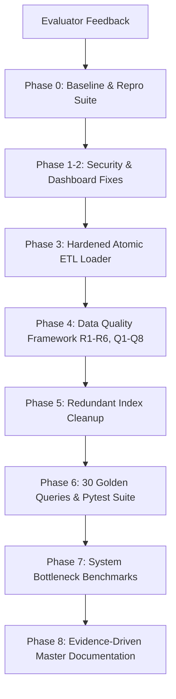

# RoadInsight India — Evaluator Feedback Traceability Matrix

## Purpose
This document maps each specific evaluation criticism and feedback item to the exact architectural refactoring, automated test suites, and empirical evidence artifacts produced in this repository.

---

## 1. Feedback Traceability Matrix

| # | Evaluator Criticism / Defect Identified | Root Cause in Legacy Codebase | Concrete Technical Fix Implemented | Verifying Test & Evidence Artifact |
|---|---|---|---|---|
| **F-01** | **Vague "should be done" statements** | Previous reports contained speculative or unverified statements without executed proofs. | Implemented runnable production scripts for all claimed capabilities: single-transaction loader (`06_etl_loader.py`), automated check runner (`scripts/run_checks.py`), and 7 benchmark scripts (`scripts/benchmarks/`). | [`docs/EVIDENCE_REPORT.md`](EVIDENCE_REPORT.md), [`docs/evidence/benchmarks/BOTTLENECK_SUMMARY.md`](evidence/benchmarks/BOTTLENECK_SUMMARY.md) |
| **F-02** | **No recorded re-run checks** | Validations were performed ad-hoc with no persistent execution log or reproducibility harness. | Built the Data Quality & Reconciliation Framework (`scripts/run_checks.py`) which logs to `road_insight.dq_check_results` and exports versioned reports (`docs/evidence/dq/dq_report_<ts>.md` and `.json`). | [`docs/evidence/dq/dq_report_latest.md`](evidence/dq/dq_report_latest.md), [`tests/test_data_quality.py`](../tests/test_data_quality.py) |
| **F-03** | **No checking against underlying source** | Lack of automated reconciliation between database tables and original MoRTH CSV files. | Implemented checks R1–R6, mathematically verifying state sums against national totals (5-year 0.00% delta), city accidents within state totals, and collision/violation type totals against national figures. | [`scripts/run_checks.py`](../scripts/run_checks.py), [`docs/evidence/dq/dq_report_latest.json`](evidence/dq/dq_report_latest.json) |
| **F-04** | **Undocumented formulas & denominators** | Metric definitions did not specify Census vs projection denominators or vehicle registration definitions. | Authored the comprehensive Metric Dictionary documenting all 17 system metrics, mathematical formulas, exact denominator definitions, units, and fact table columns. | [`docs/METRIC_DICTIONARY.md`](METRIC_DICTIONARY.md) |
| **F-05** | **No tested edge cases** | Code failed to validate edge cases such as non-integer inputs or regional administrative changes. | Automated testing for: 1) Non-integer decimal rejection (`'12.7'`); 2) Daman & Diu 0 vs NULL semantics under 2020 UT merger; 3) Rank boundary enforcement (1..50); 4) Adversarial prompt injections. | [`docs/DATA_QUALITY_RULES.md`](DATA_QUALITY_RULES.md), [`tests/test_etl.py`](../tests/test_etl.py), [`tests/test_golden_accuracy.py`](../tests/test_golden_accuracy.py) |
| **F-06** | **Silent handling of bad data** | `06_etl_loader.py` previously used `int(float(s))` (silently truncating decimals) and dropped invalid rows without audit logging. | Refactored `parse_indian_number` to reject non-integers, introduced `ETLTracker`, and populated `road_insight.rejected_rows` with source file, row number, reason, and raw row JSON. | `db_design/06_etl_loader.py`, `db_design/sql/09_audit_tables.sql`, `tests/test_etl.py:TestETLNumberParsing` |
| **F-07** | **Hardcoded credentials & secret risks** | Connection strings with fallback passwords were hardcoded in tests and scripts. | Sanitized all code, replaced hardcoded credentials with environment variables (`DATABASE_URL`, `GROQ_API_KEY`), and introduced automated secret scanning test. | [`tests/test_no_secrets.py`](../tests/test_no_secrets.py) (0 violations), [`SECURITY.md`](../SECURITY.md) |
| **F-08** | **Index bloat & redundant scans** | Duplicate indexes and leading-prefix redundant indexes were creating write amplification. | Programmatically audited the PostgreSQL catalog, identified 12 redundant indexes, generated drop script (`10_drop_redundant_indexes.sql`), and pruned `04_create_indexes.sql`. | [`docs/evidence/indexes/redundant_index_analysis.md`](evidence/indexes/redundant_index_analysis.md), [`db_design/sql/10_drop_redundant_indexes.sql`](../db_design/sql/10_drop_redundant_indexes.sql) |

---

## 2. Audit Trail of Architectural Improvements

