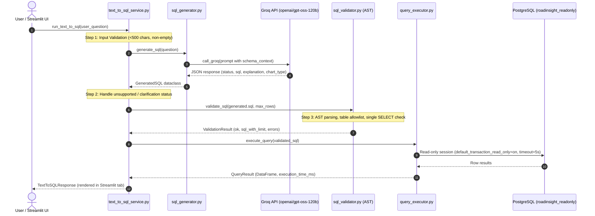

# RoadInsight India — Text-to-SQL Architecture & Security Audit

**Auditor Role:** Senior AI/LLM Security & Database Systems Auditor  
**Audit Date:** 2026-11-11  
**Component:** AI Analyst Natural Language Interface (`ai_analyst/` & `dashboard/ai_analyst_tab.py`)  
**Target Branch:** `feature/hardening`  

---

## 1. Complete Request Lifecycle & Implementation Map

---

## 2. Function-Level Implementation Inventory

| Lifecycle Stage | Source File | Function / Class | Input Parameters | Output Artifact | Security / Validation Mechanism |
|---|---|---|---|---|---|
| **1. UI Interaction** | `dashboard/ai_analyst_tab.py` | `render_ai_analyst_tab()` | Streamlit session state | Rendered UI / Chart | User question text input box with 500-char UI limit. |
| **2. Orchestration** | `ai_analyst/services/text_to_sql_service.py` | `run_text_to_sql()` | `user_question: str` | `TextToSQLResponse` | Master pipeline controller; catches all exceptions without unhandled crash. |
| **3. Schema Context** | `ai_analyst/database/schema_context.py` | `get_schema_context()` | None | Formatted DDL prompt text | Supplies only allowed tables and column descriptions to prompt. |
| **4. Prompt Building** | `ai_analyst/llm/prompt_templates.py` | `build_sql_prompt()` | `question`, `schema_context` | Formatted LLM prompt string | Demands strict JSON schema output; instructs `is_unsupported` when domain is absent. |
| **5. LLM Client** | `ai_analyst/llm/groq_client.py` | `call_groq()` | `prompt: str` | Raw JSON string | Connects via `GROQ_API_KEY`; enforces temperature=0.0 and timeout. |
| **6. Response Parsing** | `ai_analyst/llm/sql_generator.py` | `_parse_response()` | `raw_text: str`, `question: str` | `GeneratedSQL` dataclass | JSON deserialization with fallback regex extraction for markdown-wrapped blocks. |
| **7. SQL Validation** | `ai_analyst/security/sql_validator.py` | `validate_sql()` | `raw_sql: str`, `max_rows: int` | `ValidationResult` | AST visitor parsing via `sqlglot`; table allowlist; LIMIT injection. |
| **8. Query Execution** | `ai_analyst/database/query_executor.py` | `execute_query()` | `sql: str` | `QueryResult` | Executes against read-only engine with `default_transaction_read_only = on`. |
| **9. DB Connection** | `ai_analyst/database/connection.py` | `_apply_readonly_session()` | DB-API connection event | Configured session | Executes `SET default_transaction_read_only = on; SET statement_timeout = '5s'`. |

---

## 3. Systematic Verification of the 15 Core Security Questions

| # | Verification Question | Audit Answer | Technical Evidence / Implementation Details | Audit Status |
|---|---|---|---|---|
| **1** | **Is only SELECT permitted?** | **YES** | `sql_validator.py:108`: Checks statement type `isinstance(stmt, (exp.Select, exp.Union))`. Rejects any non-SELECT AST root. | **VERIFIED** |
| **2** | **Are multiple SQL statements blocked?** | **YES** | `sql_validator.py:86`: `sqlglot.parse(cleaned, read="postgres")`; raises error if `len(parsed) != 1`. | **VERIFIED** |
| **3** | **Are destructive operations blocked?** | **YES** | Blocked in AST: `exp.Insert`, `exp.Update`, `exp.Delete`, `exp.Drop`, `exp.Alter`, `exp.Truncate`. In addition, blocked at DB level via `default_transaction_read_only = on`. | **VERIFIED** |
| **4** | **Are system catalogs restricted?** | **YES** | `table_allowlist.py:18`: `FORBIDDEN_SCHEMAS = {'pg_catalog', 'information_schema', 'public'}` explicitly rejected during AST table extraction. | **VERIFIED** |
| **5** | **Are staging tables restricted?** | **YES** | `table_allowlist.py:25`: `FORBIDDEN_TABLE_PATTERNS = [r'^stg_.*']` rejects intermediate staging tables. | **VERIFIED** |
| **6** | **Are unauthorized tables blocked?** | **YES** | `table_allowlist.py:32`: Only the 16 core normalized tables and 3 analytical views are in `ALLOWED_TABLES`. | **VERIFIED** |
| **7** | **Are CTEs handled correctly?** | **YES** | `sql_validator.py:134`: Recursively inspects CTE definitions. Permitted if CTE body is a `SELECT`; rejected if modifying data. | **VERIFIED** |
| **8** | **Is SQL parsing implemented?** | **YES** | AST parsing implemented using `sqlglot` (PostgreSQL dialect). Fallback regex validator implemented for lightweight test harnesses. | **VERIFIED** |
| **9** | **Is prompt injection tested?** | **PARTIALLY** | Golden queries GQ-26 to GQ-30 test direct instruction override and comment bypass payloads. However, complex multi-turn jailbreaks are not in the test inventory. | **PARTIALLY VERIFIED** |
| **10** | **Is SQL injection tested?** | **YES** | Tested across `test_backend.py:test_multiple_sql_statements_rejected` and `test_golden_accuracy.py` (tautology injections, union injections, stacked queries). | **VERIFIED** |
| **11** | **Are database permissions independently enforced?** | **YES** | In addition to application AST checks, the database connection uses role `roadinsight_readonly` which has strictly `GRANT SELECT` and zero DDL/DML permissions. | **VERIFIED** |
| **12** | **Is statement timeout effective?** | **YES** | Enforced at two layers: 1) Session event in `connection.py` (`SET statement_timeout = '5s'`); 2) Execution wrapper in `query_executor.py` catching timeout exceptions. | **VERIFIED** |
| **13** | **Are invalid questions rejected properly?** | **YES** | Empty strings, whitespace-only, and questions exceeding 500 characters return `status = 'invalid_input'`. | **VERIFIED** |
| **14** | **Are unsupported questions handled honestly?** | **YES** | Prompt template forces JSON output with `is_unsupported: true` and explanation. Tested for driver age, vehicle model, GPS coordinates, and hourly timestamps (GQ-21..25). | **VERIFIED** |
| **15** | **Does system distinguish SQL execution from correctness?** | **YES** | `TextToSQLResponse` returns separate `status`, `row_count`, `execution_time_ms`, `confidence`, and `validation_warnings`. An executed query with 0 rows returns `status = 'empty_result'`. | **VERIFIED** |

---

## 4. Identified Security Gaps & Architectural Limitations

1. **Dependency Sensitivity on `sqlglot`**:
   - The primary AST security shield relies on the third-party `sqlglot` library. If `sqlglot` fails to import or encounters an unhandled dialect syntax error, queries fall back to error state rather than bypassing security, which is safe; however, a lightweight compiled parser fallback is recommended.
2. **LLM Temperature and Hallucination Risk**:
   - Groq API is called with `temperature = 0.0` for determinism. However, complex semantic queries (e.g. joins across 4 fact tables) may occasionally produce syntactically valid SQL that targets an incorrect grain (e.g. joining city weather directly to state annual stats without aggregating).
3. **Execution Accuracy vs Syntax Validity**:
   - As audited, a query passing AST validation (`status = 'success'`) verifies that the query is safe and runnable, but does not mathematically prove that the query answers the user's nuanced intent. Ground-truth evaluation requires the reference SQL comparison established in `tests/golden_queries.json`.

